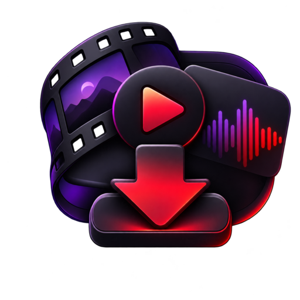
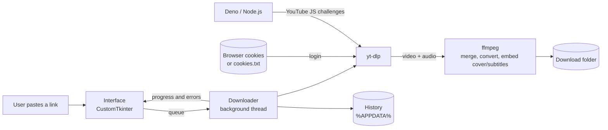

<p align="center"></p>

# VidNeon

**Download videos and audio** — free, ad-free and open source.


[Português](README.md) · **English**

A free, ad-free, open-source Windows desktop app to download videos and audio from YouTube (and hundreds of other sites) in a few clicks.

---

## The problem

Downloading a YouTube video should be simple, but in practice:

- **Download websites** charge credits or subscriptions, are full of ads and pop-ups, cap the quality, or make you install an app of unknown origin.
- **Free, trustworthy tools** such as [yt-dlp](https://github.com/yt-dlp/yt-dlp) work very well, but only from the terminal. For non-technical users, setting up formats, cookies and dependencies is hard.
- **YouTube blocks downloads all the time.** The most common errors are:
  - *"Sign in to confirm you're not a bot"*: YouTube requires a login.
  - *"Requested format is not available"*: YouTube now requires a JavaScript runtime to unlock the formats.
  - Age-restricted or members-only videos, which also require a login.
- **To use your login with these tools** you have to export cookies from the browser. On top of that, browsers such as Chrome, Edge and Opera GX lock their cookie file while open, and the resulting error doesn't say what to do.

## The solution

VidNeon puts yt-dlp behind a simple interface and handles the problems above on its own:

| Problem | How the app solves it |
|---|---|
| Paid or ad-filled websites | Runs locally, free, with no ads and no limits. |
| The command line is hard | Paste the link, pick the quality and click **Download**. |
| "I'm not a robot", age restriction | Uses the login you already have in your browser (Opera GX, Opera, Chrome, Edge, Brave, Vivaldi, Firefox) or a `cookies.txt`. The **Test login** button confirms that it works. |
| Browser locking its cookies | Detects that the browser is open and offers to close it before downloading. |
| "Format not available" | Checks whether Deno (or Node.js) is installed and installs it in one click via `winget`. |
| Components that are hard to install and remove | The *Components* screen installs and uninstalls ffmpeg, Deno, Node.js and VLC in one click. |
| Low quality and no MP3 | Checks whether ffmpeg is installed and installs it in one click. With it, the app merges high-quality video and audio and converts to MP3. |
| Technical error messages | Turns each error into an explanation of what to do, in English or Portuguese. |
| YouTube changed and the app stopped working | Every new app version is built with the latest yt-dlp, and the app tells you when an update is available. |

## Features

- **Download queue**: paste several links at once. Each item shows its thumbnail, progress, speed and time left, and can be cancelled or retried.
- **Quality**: best available, 1080p, 720p, 480p, MP3 or M4A.
- **Whole playlists**, saved in a subfolder named after the playlist.
- **Subtitles** in the languages you choose, embedded in the video.
- **Thumbnail preview** of every video or audio file, in the queue and in the list, even with the embed-cover option off. For older files, the thumbnail is generated from the file itself.
- **Player and play queue** (Spotify-style): videos and audio play inside the app. A bar pinned to the bottom, on every screen, shows the cover, title and channel, with shuffle, repeat, a seek bar and volume. The **Now playing** screen shows the video (or the audio cover) and the queue, which you can reorder by **dragging** items. In full screen, the controls appear when you move the mouse. In the Library: *Play*, *Play next* and *Add to queue*. It uses VLC; without it, the file opens in the Windows player.
- **Playlists**: each item of a downloaded playlist goes into the Library with its channel and playlist name. The *Playlists* tab lets you play a whole playlist and **change its cover**, which is applied in the app, as `folder.jpg` in the folder and, if you want, inside the files (.mp3, .m4a, .mp4).
- **Metadata and cover** (title, channel, chapters and thumbnail) written into the file.
- **Download folder** shown on the main screen, with buttons to open and change it.
- **Library**: a list of downloaded videos (title, channel, format and date), with search and buttons to play, open the folder, download again or delete. If the file is still in the folder, "Download again" asks whether you want to play the current file or replace it. When deleting, you choose between removing it from the **list only** or **deleting the file**; the file goes to the Recycle Bin and the app warns you before deleting.
- **Pastes links on its own** when you copy a YouTube link and switch back to the app.
- **Languages**: English and Portuguese, switchable instantly in *Settings › General*.
- **Windows 11-style interface**: sidebar, borderless lists, grouped settings, light and dark themes, brand colors (neon rose and violet) and native Windows icons (Segoe Fluent Icons).
- **Subtle animations** (hover, tab changes, notifications, progress) that respect the Windows reduce-animations setting and can be turned off in *Settings › General*.
- **Updates**: *Settings › About › Check for updates* compares your version with the latest GitHub Release and, in the installed app, downloads and runs the new installer. The automatic check (once a day) can be turned off.
- **Shortcuts**: Ctrl+V pastes the link and starts downloading · Ctrl+L focuses the link field · Ctrl+1/2/3/4 switch between Download, Library, Now playing and Settings · Space pauses/resumes · F11 full screen (video) · Esc leaves full screen.
- **Theme**: light, dark or follow the system.
- **Installer** in English or Portuguese, with a choice of installation folder.

## How it works



1. **Interface** (`app/gui.py`): takes the links and adds each one to the queue. The interface never freezes, because downloads run in another thread and report progress through an event queue.
2. **Downloader** (`app/downloader.py`): builds the yt-dlp options from the settings (format, login, subtitles, post-processing) and downloads one item at a time. If the ideal format doesn't exist, it falls back to alternatives (MP4+M4A → any video+audio → single file).
3. **Login** (`app/browsers.py`): detects the installed browsers and reads cookies **locally**, using yt-dlp's own reader. Opera GX has its own profile folder, which the app passes to yt-dlp. Cookies never leave your computer.
4. **Components** (`app/deps.py`): looks for ffmpeg, Deno and Node.js in the PATH, in the WinGet links and in the folders where winget, Scoop and Chocolatey install them; installs the missing ones with `winget` and reloads the Windows PATH without a restart. If something still isn't found, *Locate…* lets you point to the executable, and `app.log` records where the app looked.
5. **Errors** (`friendly_error`): turns yt-dlp's technical message into clear guidance.
6. **Data** (`app/config.py`): settings and history are stored in `%APPDATA%\VidNeon` (`config.json` and `historico.json`). On the first run of v2, the v1 data (`%APPDATA%\BaixadorYouTube`) is copied automatically.
7. **Languages** (`app/i18n.py`): all text lives in one dictionary per language. The starting language is the one chosen in the installer; if there is none, it is the Windows language.

---

## Installation

The repository's **Releases** tab offers two options:

- **`VidNeon-Setup.exe`** (recommended): installer in English or Portuguese. If you already have v1 ("YouTube Downloader"), it upgrades the existing installation. It lets you choose the installation folder, creates Start Menu shortcuts and, optionally, a Desktop shortcut, and shows up in *Settings › Apps* for uninstalling. It doesn't ask for an administrator password.
- **`VidNeon.exe`** (portable): runs directly, no installation.

If Windows SmartScreen shows a warning, click *More info* and then *Run anyway*. The app has no paid code-signing certificate.

### First run

1. If the yellow "Missing components" bar appears, click **Install now** to install ffmpeg and Deno.
2. In **Settings › Login**, choose the browser where you are logged in and click **Test login**.
3. In the **Download** screen, paste the link, choose the quality and click **Download**.

## Troubleshooting

| Message | What to do |
|---|---|
| "YouTube asked for a login" | Set up the browser where you are logged in and click **Test login**. |
| "No formats available" | Install Deno in **Settings › Components** and reopen the app. |
| "Could not read the cookies" | Fully close the browser (including the tray icon) or use a `cookies.txt`. |
| "The browser encrypted its cookies" | Use Firefox or export a `cookies.txt` with the *Get cookies.txt LOCALLY* extension. |
| Low-quality video | Install ffmpeg. |
| ffmpeg/Deno installed but "Not found" | In **Settings › Components**, click **Locate…** and point to the `.exe` (for example `%LOCALAPPDATA%\Microsoft\WinGet\Packages\...\ffmpeg.exe`). `app.log` shows where the app looked. |

---

## For developers

### Run from source

```powershell
git clone https://github.com/GuiSysLima/desktube-downloader.git
cd desktube-downloader
python -m venv .venv
.\.venv\Scripts\Activate.ps1
pip install -r requirements.txt
python run.py
```

### Build the .exe and the installer locally

```powershell
.\build.ps1
```
The script creates `dist\VidNeon.exe`. If Inno Setup is installed (`winget install JRSoftware.InnoSetup`), it also creates `dist\VidNeon-Setup.exe`.

### Release a version (GitHub Actions)

The `.github/workflows/build.yml` workflow builds everything on a GitHub Windows machine:

```powershell
git tag v2.0.0
git push origin v2.0.0
```
After about 5 minutes, the `v2.0.0` Release appears with the installer and the portable `.exe`. To test without publishing, use *Actions › Build Windows › Run workflow*.

### Add a language

1. In `app/i18n.py`, copy the `"en"` dictionary to a new code (for example `"es"`), translate the text and add the language to `LANGUAGES`.
2. In `installer.iss`, add the language under `[Languages]` and a `<language>.AppName=` line under `[CustomMessages]`. Then add the name Inno Setup uses for that language (for example `"spanish": "es"`) to the mapping in the `_installer_language` function in `app/i18n.py`.

### Structure

```
app/
  main.py        entry point
  gui.py         main window: sidebar, pages, player bar, events
  ui/            pages: download.py, library.py, playing.py, settings.py (+ common.py)
  downloader.py  queue and yt-dlp integration
  browsers.py    browser detection and cookie reading
  deps.py        ffmpeg / Deno / Node and winget installation
  config.py      settings and history
  fsutil.py      sending files to the Recycle Bin
  i18n.py        translations (pt / en)
  theme.py       design system: colors, fonts, radii, spacing, icons
  widgets.py     reusable UI components (cards, buttons, dialogs, toasts)
  thumbs.py      cached thumbnails (preview)
  player.py      playback engine: queue + VLC (Playback)
  covers.py      custom covers (app, folder.jpg, inside the file)
  updater.py     update check against GitHub Releases
assets/          app icon (.ico / .png)
cli/             terminal version (simple script)
LICENSE          GPL-3.0 text
NOTICE           additional terms (required attribution) and third-party licenses
run.py           shortcut: python run.py
build.ps1        builds the .exe and the installer locally
installer.iss    installer script (Inno Setup, pt/en)
```

---

## Privacy and responsible use

- Everything runs on your computer. The app sends no data to any server. The only connection besides the downloads is the optional update check against the GitHub API.
- Cookies are read only at download time and are not stored by the app. **Never commit your `cookies.txt`**: `.gitignore` already blocks it.
- Only download content you have the right to use, such as your own videos, freely licensed videos or personal copies allowed by your country's law, and respect YouTube's Terms of Service.

---

## License

VidNeon is **free software**, licensed under the **[GNU GPL version 3](LICENSE)** (`GPL-3.0-only`), with the [additional terms](NOTICE) allowed by section 7 of the license:

- **Attribution is required:** every distributed copy, original or modified, must keep the credit *"Based on VidNeon by Guilherme Felix (GuiSysLima)"* with the project link visible in the **About** screen, along with the `NOTICE` file and the copyright notices in the source code.
- **Modified versions** must state that they are modified and must not pass themselves off as the original.
- The **"VidNeon" name and logo** may not be used to identify modified versions.
- Modified versions that are distributed must also be **GPL-3.0, with their source code available**.

You are free to use, study, modify and share VidNeon, as long as you follow these rules. The program comes with **no warranty**.

© 2026 Guilherme Felix (GuiSysLima). Third-party libraries and components have their own licenses; see the list in the [NOTICE](NOTICE) file.
