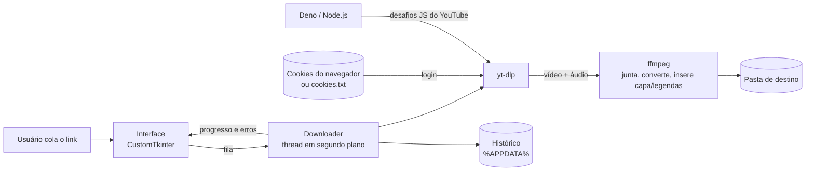

# Baixador de YouTube

**Português** · [English](README.en.md)

Aplicativo desktop para Windows, gratuito, sem anúncios e de código aberto, para baixar vídeos e áudios do YouTube (e de centenas de outros sites) com poucos cliques.

---

## O problema

Baixar um vídeo do YouTube deveria ser simples, mas na prática:

- **Os sites de download** cobram créditos ou assinatura, enchem a tela de anúncios e pop-ups, limitam a qualidade ou obrigam a instalar um app que ninguém sabe de onde vem.
- **As ferramentas gratuitas e confiáveis**, como o [yt-dlp](https://github.com/yt-dlp/yt-dlp), funcionam muito bem, mas só pelo terminal. Para quem não é técnico, configurar formatos, cookies e dependências é complicado.
- **O YouTube bloqueia downloads com frequência.** Os erros mais comuns são:
  - *"Sign in to confirm you're not a bot"*: o YouTube exige login.
  - *"Requested format is not available"*: o YouTube passou a exigir um interpretador de JavaScript para liberar os formatos.
  - Vídeos com restrição de idade ou só para membros, que também exigem login.
- **Para usar o login nessas ferramentas**, é preciso exportar cookies do navegador. Além disso, navegadores como Chrome, Edge e Opera GX bloqueiam o arquivo de cookies enquanto estão abertos, e o erro resultante não explica o que fazer.

## A solução

O Baixador de YouTube coloca o yt-dlp atrás de uma interface simples e resolve sozinho os problemas acima:

| Problema | Como o app resolve |
|---|---|
| Sites pagos ou cheios de anúncios | Roda localmente, é gratuito e não tem anúncios nem limites. |
| Linha de comando é difícil | Basta colar o link, escolher a qualidade e clicar em **Baixar**. |
| "Não sou um robô", restrição de idade | Usa o login que você já tem no navegador (Opera GX, Opera, Chrome, Edge, Brave, Vivaldi, Firefox) ou um `cookies.txt`. O botão **Testar login** confirma se está funcionando. |
| Navegador bloqueando os cookies | Detecta que o navegador está aberto e oferece fechá-lo antes de baixar. |
| "Formato não disponível" | Verifica se o Deno (ou o Node.js) está instalado e instala com um clique pelo `winget`. |
| Qualidade baixa e falta de MP3 | Verifica se o ffmpeg está instalado e instala com um clique. Com ele, o app junta vídeo e áudio em alta qualidade e converte para MP3. |
| Mensagens de erro em inglês técnico | Traduz cada erro numa explicação do que fazer, em português ou inglês. |
| O YouTube mudou e o app parou de funcionar | Cada versão nova do app é compilada com o yt-dlp mais recente, e o app avisa quando há atualização. |

## Funcionalidades

- **Fila de downloads**: dá para colar vários links de uma vez. Cada item mostra o progresso, a velocidade e o tempo restante, e pode ser cancelado ou baixado de novo.
- **Qualidade**: melhor disponível, 1080p, 720p, 480p, MP3 ou M4A.
- **Playlists inteiras**, salvas numa subpasta com o nome da playlist.
- **Legendas** no idioma que você escolher, inseridas direto no vídeo.
- **Metadados e capa** (título, canal, capítulos e miniatura) gravados no arquivo.
- **Pasta de destino** visível na tela principal, com botões para abrir e trocar.
- **Vídeos baixados**: lista com busca e botões para abrir o arquivo, abrir a pasta, baixar de novo ou excluir. Ao excluir, você escolhe entre remover **só da lista** ou **apagar o arquivo**; o arquivo vai para a Lixeira e o app avisa antes de apagar.
- **Cola o link sozinho** quando você copia um link do YouTube e volta para o app.
- **Idiomas**: português e inglês, com troca na hora em *Configurações › Idioma*.
- **Tema** claro, escuro ou igual ao do sistema.
- **Instalador** em português ou inglês, com escolha da pasta de instalação.

## Como funciona



1. **Interface** (`app/gui.py`): recebe os links e coloca cada um na fila. A interface nunca trava, porque os downloads rodam em outra thread e mandam o progresso por uma fila de eventos.
2. **Downloader** (`app/downloader.py`): monta as opções do yt-dlp de acordo com as configurações (formato, login, legendas, pós-processamento) e baixa um item por vez. Se o formato ideal não existir, tenta alternativas (MP4+M4A → qualquer vídeo+áudio → arquivo único).
3. **Login** (`app/browsers.py`): detecta os navegadores instalados e lê os cookies **localmente**, com o leitor do próprio yt-dlp. O Opera GX tem uma pasta de perfil própria, que o app informa ao yt-dlp. Os cookies nunca saem do seu computador.
4. **Componentes** (`app/deps.py`): procura o ffmpeg, o Deno e o Node.js, instala os que faltarem com o `winget` e relê o PATH do Windows sem precisar reiniciar.
5. **Erros** (`friendly_error`): converte a mensagem técnica do yt-dlp numa orientação clara.
6. **Dados** (`app/config.py`): as configurações e o histórico ficam em `%APPDATA%\BaixadorYouTube` (`config.json` e `historico.json`).
7. **Idiomas** (`app/i18n.py`): todos os textos ficam num dicionário por idioma. O idioma inicial é o escolhido no instalador; se não houver, é o idioma do Windows.

---

## Instalação

Na aba **Releases** do repositório há duas opções:

- **`BaixadorYouTube-Setup.exe`** (recomendado): instalador em português ou inglês. Deixa escolher a pasta de instalação, cria atalhos no Menu Iniciar e, se quiser, na Área de Trabalho, e aparece em *Configurações › Aplicativos* para desinstalar. Não pede senha de administrador.
- **`BaixadorYouTube.exe`** (portátil): roda direto, sem instalar.

Se aparecer o aviso do Windows SmartScreen, clique em *Mais informações* e depois em *Executar assim mesmo*. O app não tem assinatura digital paga.

### Primeiro uso

1. Se aparecer a faixa amarela "Faltam componentes", clique em **Instalar agora** para instalar o ffmpeg e o Deno.
2. Em **Configurações › Login do YouTube**, escolha o navegador em que você está logado e clique em **Testar login**.
3. Na aba **Baixar**, cole o link, escolha a qualidade e clique em **Baixar**.

## Problemas comuns

| Mensagem | O que fazer |
|---|---|
| "O YouTube pediu login" | Configure o navegador em que você está logado e clique em **Testar login**. |
| "Nenhum formato disponível" | Instale o Deno em **Configurações › Componentes** e reabra o app. |
| "Não foi possível ler os cookies" | Feche o navegador por completo (inclusive o ícone perto do relógio) ou use um `cookies.txt`. |
| "O navegador criptografou os cookies" | Use o Firefox ou exporte um `cookies.txt` com a extensão *Get cookies.txt LOCALLY*. |
| Vídeo em qualidade baixa | Instale o ffmpeg. |

---

## Para desenvolvedores

### Rodar pelo código-fonte

```powershell
git clone https://github.com/SEU_USUARIO/baixador-youtube.git
cd baixador-youtube
python -m venv .venv
.\.venv\Scripts\Activate.ps1
pip install -r requirements.txt
python run.py
```

### Gerar o .exe e o instalador localmente

```powershell
.\build.ps1
```
O script gera o `dist\BaixadorYouTube.exe`. Se o Inno Setup estiver instalado (`winget install JRSoftware.InnoSetup`), gera também o `dist\BaixadorYouTube-Setup.exe`.

### Publicar uma versão (GitHub Actions)

O workflow `.github/workflows/build.yml` compila tudo numa máquina Windows do GitHub:

```powershell
git tag v1.0.0
git push origin v1.0.0
```
Depois de uns 5 minutos, a Release `v1.0.0` aparece com o instalador e o `.exe` portátil. Para testar sem publicar, use *Actions › Build Windows › Run workflow*.

### Adicionar um idioma

1. Em `app/i18n.py`, copie o dicionário `"en"` para um código novo (por exemplo, `"es"`), traduza os textos e inclua o idioma em `LANGUAGES`.
2. Em `installer.iss`, adicione o idioma em `[Languages]` e uma linha `<idioma>.AppName=` em `[CustomMessages]`. Depois, inclua o nome que o Inno Setup usa para esse idioma (por exemplo, `"spanish": "es"`) no mapeamento da função `_installer_language`, em `app/i18n.py`.

### Estrutura

```
app/
  main.py        ponto de entrada
  gui.py         interface (CustomTkinter)
  downloader.py  fila e integração com o yt-dlp
  browsers.py    detecção de navegadores e leitura de cookies
  deps.py        ffmpeg / Deno / Node e instalação pelo winget
  config.py      configurações e histórico
  fsutil.py      envio de arquivos para a Lixeira
  i18n.py        traduções (pt / en)
cli/             versão de terminal (script simples)
run.py           atalho: python run.py
build.ps1        gera o .exe e o instalador localmente
installer.iss    script do instalador (Inno Setup, pt/en)
```

---

## Privacidade e uso responsável

- Tudo roda no seu computador. O app não envia dados para nenhum servidor. A única conexão além dos downloads é a verificação opcional de atualizações na API do GitHub.
- Os cookies são lidos só na hora do download e não são salvos pelo app. **Nunca envie seu `cookies.txt` para o repositório**: o `.gitignore` já bloqueia esse arquivo.
- Baixe apenas conteúdo que você tem direito de usar, como seus próprios vídeos, vídeos com licença livre ou cópias para uso pessoal permitidas pela lei do seu país, respeitando os Termos de Serviço do YouTube.
